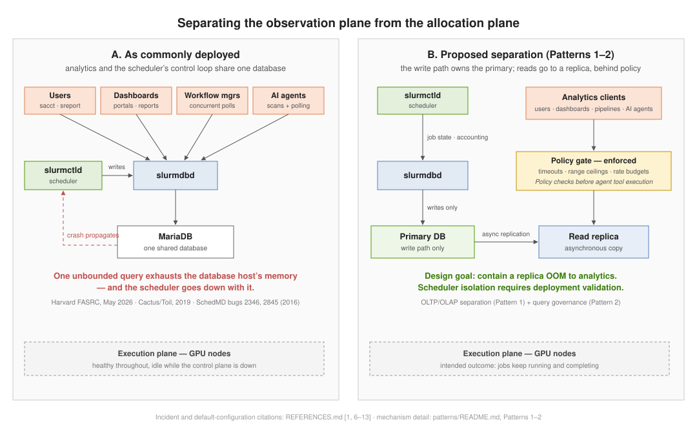
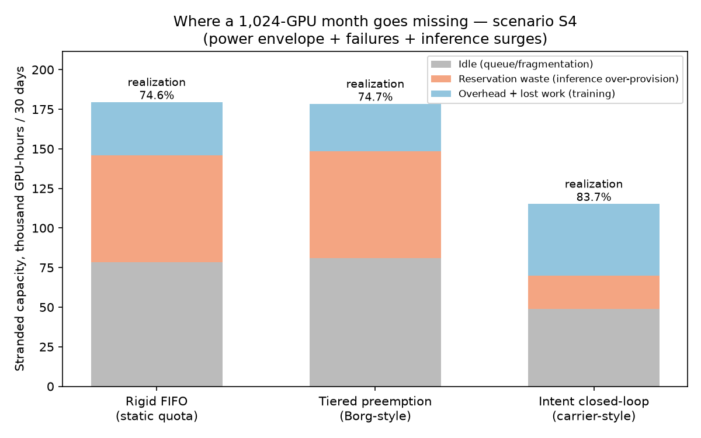
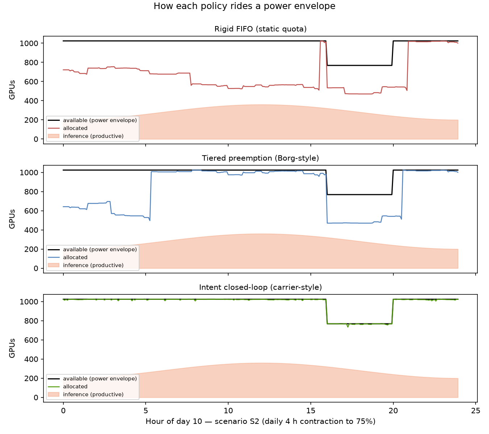
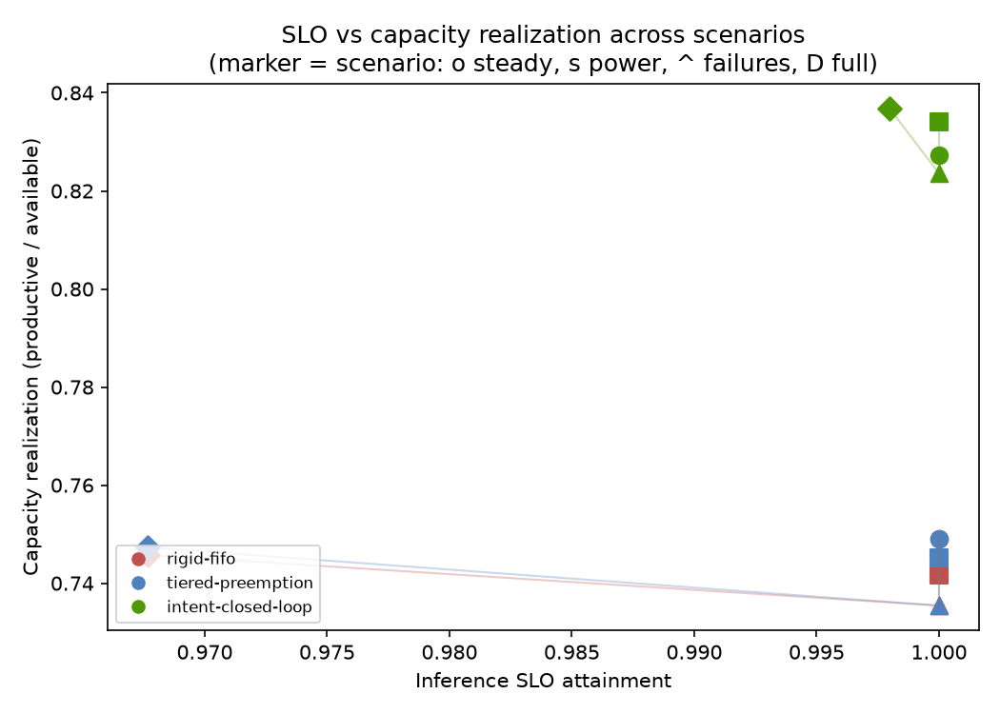

# Scheduled Capacity: Turning Scattered GPUs into Working AI Clusters

For offline JSON replay, workload-specific capacity projections and adapters to
the existing torus/admission packages, see [capacity interfaces](capacity/README.md).
These extend the simulator; they are not production scheduler bindings.

**The AI-infrastructure market prices GPUs, power, and interconnect. It does not price the layer that converts them into usable capacity: allocation.** This repository examines how allocation policies change modeled usable capacity, using a reproducible simulator and public research. The results are scenario comparisons, not a universal return-on-investment ranking.

<!-- research:headline:begin -->
**Corrected experiment (offered-load correction: 2026-09-10):** on a simulated 1,024-GPU cluster over 30 days, with a public-research-informed synthetic workload, power constraints, failures and demand surges (S4), the intent policy realizes **83.7%** of the available envelope versus **74.6%** for rigid FIFO. The difference is **~64,267 modeled productive GPU-hours (~89.3 continuously productive GPU equivalents)**. These are modeled output differences, not GPUs purchased or production savings. The comparison bundles reservation tracking and elasticity; it does not isolate their causal contributions.
<!-- research:headline:end -->

*Sequel to [network-vs-more-gpus](https://github.com/dimaggi-ai/network-vs-more-gpus) ("Network Capacity Is Compute Capacity"). All factual claims trace to [REFERENCES.md](REFERENCES.md).*

*The whole argument in one document — model, results, validation, and the limits — is the whitepaper: [paper/paper.md](paper/paper.md).*

---

## 1. Capacity accounting: usable = nominal × A × E × P

Over a window of H hours on N accelerators, usable capacity is nominal capacity discounted three times:

- **A — scheduler availability**: can the allocation plane admit and place work?
- **E — allocation efficiency**: of schedulable accelerator-hours, how many are allocated?
- **P — productive ratio**: of allocated accelerator-hours, how many produce forward progress? Meta's ETTR uses a different denominator: scheduled time plus time eligible for scheduling while waiting in the queue [34, §II-D]. It cannot be substituted for P.

The [calculator](calculator/) computes the three loss layers. The following arithmetic examples use a 720-hour window; their assumed fleet sizes and rates are explicit, and they are not measurements of recovered productive capacity:

| Worked example (30-day window) | Layer | Stranded GPU-hours |
|---|---|---|
| Harvard emergency scheduler patch, Aug 2026 — whole fleet paused ~3.7 h [4, 4a] | scheduler (A) | **3,700** |
| Illustrative 16k fleet with **assumed P = 0.90** (not Meta ETTR) | productivity (P) | **1,152,000** |
| 155,410-GPU fleet using Alibaba's 68% **high-priority-only** allocation ratio [37] | allocation (E) | **35,806,464** |

These examples compare different fleets and assumptions, so they do not establish a
universal ranking of losses. Alibaba reports 68% allocation for high-priority (HP)
jobs alone and 93% when lower-priority, interruptible (LP) jobs are included [37,
§3.3, Fig. 9]. Applying that 25-point difference to 155,410 GPUs for an **assumed
720 hours** gives 27,973,800 additional *allocated* GPU-hours, not measured
productive hours, extra HP guarantees or a before/after controlled intervention.
LP capacity can be reclaimed for HP work; its service terms differ [37, §4.2].

```
python3 calculator/stranded_capacity.py --list-presets
python3 calculator/stranded_capacity.py --preset typical-composite
```

An illustrative composite cluster (all assumptions: one 4 h control-plane event, 80% allocation, 0.90 productive ratio) realizes **71.6%** of its nominal month. The control-plane event — the thing that gets a postmortem — contributes 2% of that loss.

## 2. Different measures of utilization

Most "GPUs are idle" claims mix incommensurable metrics. Keep them apart:

| Metric | What it measures | Cited values |
|---|---|---|
| **Allocation ratio** | share of fleet accelerator-hours assigned to a stated workload population | Alibaba ASI: 68% HP-only; 93% HP + interruptible LP on the same 155,410-GPU fleet [37] |
| **Hardware utilization** | busy fraction of *allocated* GPUs | ~52% average, Microsoft Philly training cluster [35] |
| **Instance SM usage** | accelerator-equivalent SM usage per task instance; a different population and unit from fleet utilization | Median 0.042 GPU-equivalents, Alibaba PAI [36, §3.3/Fig. 5(b)] |
| **Productive ratio P (this model)** | productive / allocated accelerator-hours; queue time excluded | Synthetic training ratios in the experiment table below |
| **ETTR (Meta)** | useful training time / (scheduled time + eligible queue waiting); includes failure/restart effects | Near 0.9 for multi-day 2–4k-GPU jobs under the paper's checkpoint/restart assumptions [34] |

Only A, E and P with the aligned denominators defined above form this accounting identity. Hardware utilization, MFU, goodput and Meta ETTR are distinct measurements; they cannot be multiplied or substituted indiscriminately. A high allocation ratio alone does not demonstrate productive progress.

## 3. The allocation plane is also where clusters break

The scheduler control plane, not the GPUs, is the recurring point of failure — a pattern, not an incident (details and primary sources: [case studies](docs/case-studies.md), patterns 1–3 of [patterns/](patterns/README.md)):

- SchedMD's tracker warned in **2016** that user queries "can DoS the box" (bugs 2346, 2845 [8, 9]).
- A workflow manager's ~1,000 concurrent `sacct` polls "crashed our SLURM db" at one site, **2019** [11].
- Harvard FASRC, **June 2023**: ~6.5 days of scheduler degradation; root cause never publicly identified [2, 3].
- Harvard FASRC, **May 2026**: one oversized `sacct` query OOM'd the accounting database host and crashed the scheduler — sub-hour hard outage, multi-day degraded operation, permanent query caps [1].
- Harvard FASRC, **Aug 2026**: emergency cluster-wide pause (~3.7 h) to patch a scheduler memory leak; the upgrade itself terminated jobs [4a, 4b].
- Meta, **2024**: a 1,024-GPU job encountered `NODE_FAIL` and was subsequently requeued 35 times, causing **548 preemptions** of other jobs — a reported node failure followed by scheduling cascades [34].

These incidents illustrate two roles for the allocation plane: it can originate a disruption or amplify a hardware fault, as in Meta's example.

**Agent requests also need bounds.** Harvard's May 2026 postmortem asks users to
limit agent queries [1]. A vendor-neutral policy gate can enforce query ranges,
field scope, concurrency and request budgets before tools reach the accounting
service, with recorded decisions and escalation for exceptions. These are proposed
architecture controls; this simulator does not implement or evaluate a policy-gate
product, and its research results do not depend on one.



## 4. The experiment: three allocation policies, one month, same cluster

The [simulator](sim/) runs a 1,024-GPU cluster for 30 days under four scenarios (steady state; a daily 4 h power contraction to 75%; Meta-rate node failures; all of it plus inference surges). The workload is calibrated to Meta's published job-size findings — most jobs tiny, most GPU-time in large jobs [34] — and all three policies face the *identical* job stream and events:

- **rigid-fifo** — FIFO + backfill, rigid sizes, no preemption, peak-provisioned inference reservation; sheds power by emergency-killing newest jobs. A conservative Slurm configuration.
- **tiered-preemption** — adds Borg-style priority tiers and graceful checkpoint-preemption [25]. Still rigid sizes, still peak-provisioned.
- **intent-closed-loop** — the carrier-network pattern (§5): a 15-minute controller tracks inference demand with 10% headroom instead of peak-provisioning, shrinks elastic training jobs before escalating to graceful preemption, and degrades in a declared hierarchy under scarcity.

Results (means over 3 seeds; full grid in [results/](results/), reproduce with `python3 sim/run.py`):

<!-- research:s4-table:begin -->
| Scenario S4 (power + failures + surges) | rigid-fifo | tiered-preemption | intent-closed-loop |
|---|---|---|---|
| Capacity realization | 0.746 | 0.747 | 0.837 |
| Inference SLO attainment | 0.968 | 0.968 | 0.998 |
| Training productive / allocated GPU-h (legacy `train_ettr` field) | 0.906 | 0.915 | 0.895 |
| Stranded GPU-h / month | 179,424 | 178,375 | 115,156 |
| — of which reservation waste | 67,416 | 67,416 | 21,154 |
| Kills / preemptions / resizes | 289 / 0 / 0 | 28 / 203 / 0 | 28 / 219 / 1083 |
| Mean started-job wait (h) | 1.3 | 1.2 | 1.5 |
<!-- research:s4-table:end -->







What the numbers say:

<!-- research:readme-findings:begin -->
1. **Scenario means:** intent exceeds rigid FIFO by 7.8–9.2 percentage points. S4 reservation waste is lower by ~46,262 GPU-hours; that ledger difference does not isolate the causal contributions of tracking and elasticity.
2. **Aggregate inference attainment:** 0.998 for intent versus 0.968 for the static policies. The modeled surges exceed the static reservation by construction; this is not request-level latency validation.
3. **Churn and training:** intent performs ~1,083 resizes and ~219 graceful preemptions versus ~203 preemptions for tiered. Its training productive/allocated ratio is 0.895 versus 0.906/0.915; mean started-job wait is 1.5 h versus 1.3/1.2 h. Never-started jobs are excluded from that wait metric.
4. **Tiered preemption:** emergency kills fall from ~289 to 28 while realization moves from 0.746 to 0.747; fixed inference reservations remain.
5. **Scope:** these conditional model results do not establish a production guarantee, universal policy ordering or hardware purchase avoided.
<!-- research:readme-findings:end -->

**Honest limitations:** 5-minute steps; linear elastic scaling (optimistic — resize also pays an explicit overhead step); graceful preemption checkpoints at zero marginal cost at the moment of preemption (optimistic for both preempting policies; emergency kills do lose uncheckpointed work); the static policies' reservation is deliberately sized to the diurnal peak rather than to rare surges, mirroring common practice — sizing to surges would trade the SLO misses for deeper reservation waste; aggregate inference demand rather than per-request latency; abstracted node placement; single tenant. The simulator measures *policy structure*, not vendor performance; absolute numbers and policy ordering may differ with workload and site assumptions. The reported ordering is limited to these scenarios. Invariants are enforced by [tests](sim/test_sim.py) (conservation of GPU-hours, determinism per seed, policy behavioral contracts).

## 5. The pattern is older than AI: what carrier networks already learned

Telecommunications networks allocated a scarce, shared, congestible resource under SLOs a generation before GPU clusters — and their end state is documented in the patent record:

- **US 2020/0112876** (application-aware congestion management): detect congestion, identify *heavy users* and *suffering users*, iteratively shape the heavy until the suffering recover [40].
- **US 11,128,536** (intent-based traffic management): the operator declares *outcomes*; an allocation module sets per-class floors and targets; quality is measured continuously; shapers re-allocate in a closed loop; under scarcity, a strict class hierarchy degrades first-things-first [41].

Map it to AI compute: **training jobs are the heavy users** (elastic, throughput-hungry, checkpointable); **inference is the suffering user** (latency-bound, SLO-visible); *intent* is training-throughput targets, inference SLOs, and power/cost envelopes; the feedback signal is goodput rather than link QoE. The simulated intent policy above is this patent pattern transplanted — and the ecosystem is already converging on it: Google's Dynamic Workload Scheduler ("built on Google Borg technology," TPUs and GPUs [32]) schedules against declared duration and flexibility; queued resources and Spot tiers price priority [31]; Kueue, Volcano, and KAI ship gang scheduling, topology awareness, and preemption hierarchies on Kubernetes [19–21]. Closed-loop allocation already exists in prior work: Pollux monitors training jobs and reallocates resources using modeled goodput, with an open implementation in AdaptDL [45]. This repository studies a specific combination of inference reservation tracking, elastic training and constrained capacity; it does not claim to originate feedback-driven scheduling.

Six architecture patterns for getting there — from plane separation to power-as-a-schedulable-resource — are in [patterns/](patterns/README.md).

## 6. The TPU parallel

Google is the existence proof that the end state works, because it co-designed the scheduler and the fabric ([full hypothesis](docs/tpu-parallel.md)):

- Borg has run priority bands, quota-priced admission, and cascade-suppressed preemption since before 2015 [25].
- TPU v4's optical circuit switches relax contiguity between complete 64-chip blocks, while other placement constraints remain: *"For TPU v3, a 256 chip slice meant the scheduler had to find 256 contiguous chips that were idle. For TPU v4, it can pick four 4³ blocks from anywhere in the supercomputer"* — and goodput survives at 99.0–99.5% host availability where a static fabric needs 99.9% [28].
- The productized stack — Multislice, queued resources, Spot, DWS, default-on ICI resiliency [31–33] — is intent-based allocation shipped as a cloud product.

**Hypothesis:** vertically integrated accelerator ventures win on *allocation efficiency*, not only on chips — the scheduling layer is the moat. The merchant-GPU world's counter-move is visible in real time: NVIDIA acquired the Run:ai scheduler (open-sourced as KAI, 2025) and then SchedMD — Slurm itself — in December 2025 [16, 21]. The scheduling layer is consolidating under the accelerator vendor. That is the market agreeing with this repo's thesis.

## 7. Scattered GPUs, one cluster — the honest boundary

"Multi-cloud AI cluster" today means federation at the **control plane**: SkyPilot and dstack place and queue jobs across hyperscalers, neoclouds, Kubernetes, and Slurm [23, 24]; CoreWeave's SUNK Anywhere extends one Slurm-on-K8s control plane across clouds [17]. Nothing verified federates the **data plane** — no RDMA fabric spans providers, and a distributed training job still lands inside one interconnect domain. "One logical cluster" means one logical *queue*. That is genuinely valuable — it is allocation-layer consolidation, this repo's whole subject — but claims beyond it are marketing.

## 8. The validation project

The simulator carries a nine-point validation registry
([sim/validation.py](sim/validation.py)) run in CI, honestly split into
three kinds. **Calibrated** points pin constants tuned to — or sharing an
input with — published figures, so they cannot drift silently: Meta's
job-size shape and RSC-1 failure-rate constant [34]. The training productive/allocated
ratio band is an **internal sanity check**, dominated by this simulator's fixed
one-hour checkpoint interval. It is not a Meta ETTR calibration: Meta includes
eligible queue waiting and uses Daly–Young optimal checkpoint intervals with
five-minute restart and checkpoint-write overhead for Fig. 9 [34]. **Emergent** points are
behaviors nothing in the code was tuned to produce, asserted across four
seeds: large jobs queue >2× longer than small ones under rigid gang
scheduling in every seed — the direction of the Philly trace's queueing
finding in virtual cluster VC2, where >4-GPU jobs show a longer delay tail (25% wait ≥10 min vs
10% of 1-GPU jobs) and fragmentation drives ~78% of large-job delay
occurrences [35], though this saturated simulation produces far larger
ratios than the trace's minutes-scale tail; and the intent policy
realizes more of the capacity envelope than rigid FIFO in
every seed. Alibaba's 68% HP-only versus 93% HP+LP allocation ratios [37]
illustrate filling idle capacity with interruptible work, but do not validate this
model's mechanisms, causal effect or productive-capacity gain. **Sanity** points pin the model's own arithmetic and cite no
external evidence: emergency kills under power contraction lose
~1,350-2,100 GPU-h per two weeks that graceful checkpoint-preemption
preserves by construction (real Borg-style preemption warns and kills,
so it is harsher than the graceful branch here [25]); queueing grows
with offered load below saturation in every seed; and demand-tracking
cuts reservation stranding 3.4× at equal SLO — deterministic constant
arithmetic whose mechanism, not magnitude, comes from the carrier
pattern [41]. Synthetic data is the seeded workload generator itself,
deterministic per seed.

Two things keep that table from being a highlight reel. The registry
prints a **DECLINED** list on every run, naming what it does *not* check —
that no point constrains the failure model, which stays green at 10× Meta's
rate; that the *size* of the scheduling dividend and the elastic-resize
mechanism are reported but never validated; that the Philly and Alibaba
anchors are direction-only; that no real scheduler binary is exercised; and
that nothing here validates tail latency, placement, or multi-tenancy. And
[sim/test_validation.py](sim/test_validation.py) **breaks the model on
purpose** — eight mutations of three different strengths, because the
difference matters. Two delete simulator machinery: the job-size
distribution flattened, the checkpoint interval collapsed. Three swap in a
weaker policy: the intent policy replaced by rigid FIFO, graceful
preemption replaced by killing, the intent policy replaced by
peak-provisioning tiered preemption. Two collapse a comparison to guard
against tautology: the two offered loads set equal, the large-job band
compared against itself. One falsifies a pinned constant: the RSC-1 rate.
Only the first two remove a mechanism, and the last one moves no model
behavior at all. Each is required to turn a *named* point red, and
a control proves the reduced configuration used for the mutations is green
when nothing is broken. A registry nobody has watched fail is evidence
that the registry is easy, not that the model is right.

```
cd sim && python3 validation.py     # the registry, model vs public record
```

## 9. Reproduce everything

```
pip install -r sim/requirements.txt

# capacity accounting, worked examples
python3 calculator/stranded_capacity.py --preset harvard-aug2026
python3 calculator/test_stranded_capacity.py

# policy simulation: full grid (4 scenarios x 3 policies x 3 seeds, ~6 s)
(cd sim && python3 test_sim.py && python3 test_validation.py && python3 run.py)

# refresh marked README/paper results from CSV; review the surrounding prose
python3 tools/sync_research.py --write
python3 tools/sync_research.py --check --verify-run
python3 -m unittest discover -s tools -p test_research_sync.py
```

Python 3.11+, `numpy`, `matplotlib`. Every run is seeded. The publication check validates
the complete 36-run grid, recomputes displayed claims from the unrounded means and
regenerates CSV/summary in temporary repository storage. The paper prose is hand-maintained;
its marked numeric blocks and these README blocks are generated. PNG rendering is
not promised byte-identical across Matplotlib/font versions. The three reviewed plots and
figure generator are required SHA-bound artifacts; missing, replaced or unbound plots fail
the publication check. Regenerate and visually review plots before manually resealing their
provenance. See the paper's correction
provenance for the missed 2026-09-10 paper update and the corrected rounding method.

## Series

- **Network Capacity Is Compute Capacity** — the fabric determines usable compute ([network-vs-more-gpus](https://github.com/dimaggi-ai/network-vs-more-gpus))
- **The Two Workloads** — training- vs inference-shaped capital risk ([dimaggi.ai/insights](https://dimaggi.ai/insights))
- **Scheduled Capacity** (this work) — the allocation layer is where capacity is realized or stranded

---

*Margaret (Maggie) Nanyonga — Founder & Principal Architect, [DIMAGGI AI](https://dimaggi.ai). Author affiliation; no product is required to reproduce this study.*
